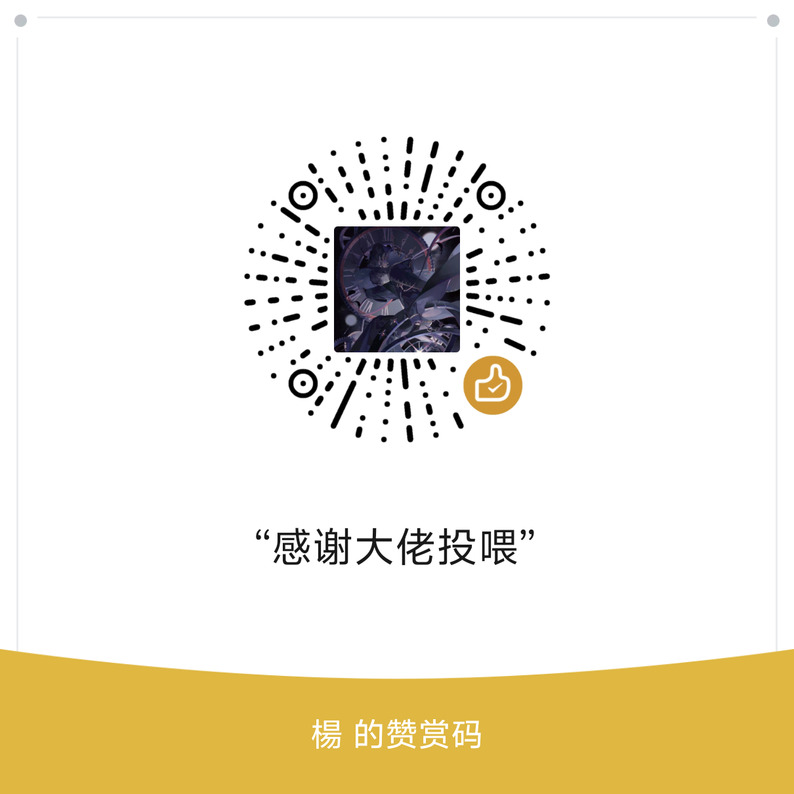

# AFK Journey 启程自动化助手（梅林初号机）

基于图像模板匹配的《剑与远征：启程》日常任务自动化工具。通过截图 + 模板匹配定位界面元素，
配合 AutoHotkey 注入点击，自动完成登录、月卡/礼包领取、主线推进、迷宫、推图、爬塔、好友赠送、
邮件、挂机等循环任务。

本项目（`schalkiii/afk-journey-merlin-auto`）基于上游 `yangyh02/afk-journey-merlin-auto` 二次开发，
在保留原项目功能的基础上做了一系列增强（见下文「本仓库相较于上游的增强」）。

---

## 功能特性

| 功能 | 说明 |
| --- | --- |
| 任务总开关 | 单一「开始运行 (F8) / 停止运行 (F9)」按钮，避免多个停止按钮的混乱 |
| 功能列表拖拽排序 | 按住功能按钮上下拖动即可调整**执行顺序**（列表顺序就是执行顺序，不再有第二份硬编码顺序表）；顺序写入 `game_bot_config.json`，重启后保持。位移小于 8 像素仍视为普通点击，不会误改顺序 |
| 公会玩法日常 | **结社战线**（挑战到失败为止，再扫荡掉剩余次数）与**狩猎悬赏**（用完自己的搜寻次数 + 参加队友悬赏）；两者共用「玩法目录 → 公会玩法」入口 |
| 家园愿望单 | 一键选择 → 交付循环交付订单；缺料时自动寻路到生产建筑补货再继续；进度奖励自动领取。补货进入生产界面后**不再点产品卡片**（该点击会误开制作配方），直接选 x10 档开始制作 |
| 红点领取 | 四个入口依次领取：菜单→任务面板（每日/公会/成长挑战/赛季任务含二级与底部页签/家园目标）、主界面「赛季手册→赛季里程碑」、菜单卡片「赛季月桂之旅」逐本手记（秋夜手记 / 赛季月桂之旅II / I / **魔法行记**；真入口在菜单第二行第 4 张卡片，客户区 (905,625)，右侧 HUD 竖排 (1550,610) 实测不是入口），**每本记内部再切 奖励 / 任务 两层，任务下扫 每日·每周·挑战 三个子页签**（只切轮播会整片漏掉周常与挑战奖励），以及「当前进度→赛季挂机关卡」的挂机收益 + 产出宝箱 + 里程碑节点；每处反复点「一键领取」和带勾选圆标的单个「领取」，弹「获得奖励」就点空白关闭，结束时强制回主界面。进面板有**两条入口**：菜单→任务 为主，若那两处模板任一失效则改点主界面左下角「目标」（它就是这个面板的直达快捷键，实测客户区 (35,747)）。**不覆盖**：翻翻乐（不是红点，已单独做成「翻翻乐自动烧钥匙」一项）、「玩法目录」活动/公会卡片列表（盲点会误闯带自动派遣的活动页，这些玩法已有专门模块）、背包/图鉴等「新」角标（无奖励可领）。右侧配置面板可**逐项关闭 8 个子项**：每日任务 / 公会任务 / 成长挑战 / 赛季任务 / 家园目标 / 赛季手册 / 月桂之旅 / 赛季挂机关卡 |
| 单独运行一个功能 | 配置面板「只运行当前功能」按钮：只跑选中的那一个功能并忽略其它勾选，用于逐项验证或补跑漏掉的一天 |
| 列表内直接勾选启用 | 功能列表每行行首一个勾选框，勾上即启用、取消即停用，改动立刻写入配置；配置子页里不再另放「开启」勾选框（同一状态两处各写一份迟早对不上）。**启用状态只由用户改**，任务跑完不会再自动取消勾选 |
| 英雄厅堂自动快速升级 | 进英雄厅堂反复点「快速升级」提升赛季共鸣等级（实测每点一次 +1 级，全员等级与总战力同步上升）。该按钮**没有确认弹窗也没有获得奖励弹窗**，故用「等级数字区域点击前后是否变化」判定成败（静止稳定 1.000，升级后掉到 0.92–0.94），资源点不动时自动停止。进厅堂后还会先扫中央宝箱与右上角领取/一键领取，命中即领。配置面板可设「快速升级次数 (1-99)」。**不代点「初识之人」红点**：那是公会结社科技树，选哪个节点决定加成方向，属于要人决策的项 |
| 翻翻乐自动烧钥匙 | 菜单 → 任务 → 翻翻乐，点「点击增加进度」把钥匙花掉。**一次单击不是 +1 而是连抽到本轮 100 满**（实测 265→219→119），翻卡与里程碑奖励静默入账无弹窗，故用「钥匙余量区域点击前后是否变化」判定成败；进度数字每满 100 归零，**不能**当判据。只用单击（`twice=False`），连点两下会白烧一整轮。配置面板可设「最多轮数 (1-50)」，余量不再变化即判定钥匙用完并停止。钥匙由钓鱼等玩法产出且每周结算清零，烧掉才是本活动的目的 |
| 仓库管理 | 按种族 + 职业筛选扫描仓库英雄，按头像边框判定练度（有花边=巅峰+及以上→高，平框→低，未扫到→未拥有），结果写入本地 `warehouse_heroes.txt`，供爬塔流程（`flow_tower`）判定「我方练度是否够这套阵容」；面板可手工勾选修正，配置首次创建后缓存、切换页签不重建 |
| 任务状态颜色标注 | 每行勾选框右侧一枚状态色块，随运行实时变化：蓝=运行中、黄=排队中、绿=完成、红=失败/错误、灰=F9 停止；**只有本轮实际要跑的已勾选功能才显示「排队」，未勾选/未轮到的行保持中性**。原来状态只写在运行日志里，要翻日志才知道跑到哪一步、哪个挂了 |
| 立即开始 | 一键「立即开始」：**游戏未运行**时才启动游戏并等待配置秒数；已在运行则跳过启动、直接运行脚本。「开始运行 (F8)」只跑脚本、不碰游戏窗口/启动器 |
| 定时开始 | 设定每天固定时间启动；触发时**自动检测游戏是否已运行**，已运行则直接运行脚本，避免重复拉起游戏 |
| 自动运行 | 勾选「运行成功后自动运行」后，每次运行结束自动重新启动循环 |
| 启动后自动运行 | 勾选「启动后自动运行」后，App 启动即开始运行（无需手动点开始） |
| 启动游戏 | 勾选「启动时启动游戏」后，定时/立即开始会先通过桌面快捷方式启动游戏，等待指定秒数后再运行脚本 |
| 游戏启动等待 | 可设置游戏启动后的等待时间（秒），支持手动输入并自动保存 |
| 全局热键 | F8 开始运行、F9 停止运行（即使窗口未聚焦也生效） |
| 检查更新 | 菜单「帮助 → 检查更新」对比本地 `version.py` 与远程 `version.json`，支持下载并自动替换 exe |
| 配置持久化 | 所有勾选项、等待时间、定时设置均写入 `game_bot_config.json`，下次启动自动恢复 |

---

## 本仓库相较于上游的增强

> 以下改动均为本仓库（schalkiii fork）新增，**上游原项目不含这些能力**。

### 1. 自动配置通关阵容（一键采用系统推荐阵容）

- 新增共享能力 `common.try_auto_configure_lineup()`：挑战/战斗前自动检测「通关阵容」入口
  （`templates/tongguanzhenrong.png`）并点击展开，再点击「一键采用」（`templates/yijiancaiyong.png`）
  套用系统推荐阵容，省去手动布阵。
- **容错**：若展开后找不到「一键采用」，则点击「点击空白处关闭」（`dianjikongbaichuguanbi.png`）
  退出阵容视图，避免卡死——与 `flow_tower` / `haoyoujiangli` 等其它流程退出阵容界面的方式一致。
- **GUI 开关**：控制栏新增「自动配置通关阵容」复选框，状态持久化到 `game_bot_config.json`
  （键 `auto_configure_lineup`）。
- **接入点**：迷梦之域（`mimengzhiyu.flow_mimengzhiyu`）与女神塔（`nvshenta.flow_nvshenta`）在每次点击战斗前
  会读取该开关，开启时自动尝试采用阵容；未检测到入口则静默跳过，不影响原有挑战流程。
- **健壮性**：采用前会**重试多次**（默认 3 次）以兼容挑战界面刚进入时的加载/动画延迟；
  展开后若找不到「一键采用」，依次尝试「点击空白处关闭」（`dianjikongbaichuguanbi`）、
  再**点击屏幕空白处兜底**，确保退出阵容视图、不卡死。
- 新增模板：`templates/tongguanzhenrong.png`、`templates/yijiancaiyong.png`。

### 2. 一键全选 / 全不选（批量勾选功能）

- 功能列表每行行首是一个**启用勾选框**（`tk.Checkbutton`，直接读写该脚本的 `enabled` 并立即落盘）；
  配置面板与之并排提供「一键全选」`GameBotGUI.enable_all_scripts()` 与「一键全不选」
  `GameBotGUI.disable_all_scripts()`，一次性把全部功能置为启用 / 停用，刷新各行勾选框并持久化。
- 启用状态**只有用户能改**：运行成功后不再自动取消勾选（旧的 `daily_reset`「完成即停用」会把
  用户的设置写回配置，导致第二天该任务被静默跳过）。该字段已整体移除。
- 便于每天启动后快速勾选 / 取消勾选所有功能，省去逐个操作。

### 3. F9 立即停止（协作式停止）

- 新增底层机制：`common.StopRequested`（继承 `BaseException`，避免被子脚本 `except Exception` 吞掉）、
  `set_stop_checker()`、`check_stop()`，并将停止检查注入 `screenshot_bgr()`、`send_coord()`、`wait_and_click()`
  等所有子脚本共用的底层原语。
- 效果：按下 F9 后，运行循环置位 `stop_event`，子脚本在**下一次截图/点击**即抛出 `StopRequested` 被立即中断，
  无需等待脚本自然跑完。运行循环捕获该异常后将脚本标记为「已停止」并退出。
- 相比上游「等当前脚本结束才停」，本改动让停止真正即时。

### 4. 子脚本日志汇聚到运行日志面板

- 新增 `common.log()` / `set_log_sink()`：子脚本统一调用 `log(...)`，未设置汇聚时回退到标准输出（便于单独调试）。
- GUI 通过 `_StdoutTee`（`bot_runtime`）把子脚本的 `print(...)` 调试日志实时转发到应用内「运行日志」面板
  （经队列 `_enqueue_log` / `_drain_log_queue` 调度到主线程写入，线程安全），同时经 `append_log_file` 持久化到 `game_bot.log`；
  `log()` 方法同样写面板并落盘，便于排错与事后查看。
- 落盘每一行都带 `[HH:MM:SS]` 前缀（GUI 与子脚本一致），便于对齐时序；文件超过 5 MB 自动轮转为
  `game_bot.log.1`，只留一份备份。`pytest` 期间日志写入被整体重定向到临时目录，不会污染这份文件。
- 子脚本 `common.log(...)` 的汇聚出口接的是 GUI 的 `log()`（不是只进面板的 `_enqueue_log`），
  所以「哪张模板没命中、哪一项领到了」这类细节行与界面里看到的一致，也会写进 `game_bot.log`。
- **统一格式在 `log_format.py`，只在出口整理一次**（GUI 的 `log()` 与 stdout tee 两条路都走它），
  不去改三十个流程模块里的 print。做三件事：任务运行期间的细节行缩进并加 `·` 归到该任务下；
  高频行压短（`caidan 识别成功，第 1 次，坐标: (3541, 958)，发送给 AHK 点击` →
  `命中 caidan (3541, 958) 第1次`；实测一份日常日志里这类行占 717 + 1322 行）；任务边界单独成行。
  面板与文件写**同一份正文**，时间戳各路由自己的加戳方式补齐，所以不会出现双时间戳：

  ```
  [14:00:30] ▶ [1/2] 邮件
  [14:00:30]   · 命中 caidan (3541, 958) 第1次
  [14:00:30]   · 未命中 exit 第2次（已等 1.1s）
  [14:00:30]   · 状态 start_battle → monitor_battle
  [14:00:30] ✔ [1/2] 邮件 · 9.3s
  [14:00:31] ✘ [2/2] 普竞 · 3.0s
  ```

  没命中压缩规则的行**原样通过**（含 `【模块名】` 前缀），格式化只动形状不动语义。

### 5. 启动性能优化：复用常驻进程 + 隐藏控制台窗口

- 每次点「开始运行」不再盲目重启 `click_from_file.exe`：新增 `is_click_from_file_running()`（用 `tasklist`
  探测），若常驻监听进程已在运行则**直接复用**，跳过重启与 `sleep`，消除约 1 秒卡顿与弹出的新终端黑框。
- 仅当进程未运行时才启动，并使用 `subprocess.CREATE_NO_WINDOW` 隐藏控制台窗口——首次启动也不再可见黑框。

### 6. 流程健壮性：统一返回主界面 & 结算弹窗清理

- **`common.find_center_silent()` 上移并增强**：原本 `flow_tower` / `nvshenta` / `pata` / `pujing` / `mimengzhiyu`
  各自重复实现的静默版 `find_center` 已去重，统一为 `common` 中的实现，并新增 `region` 参数（限定搜索范围加速）。
- **`flow_enter.flow_return_main()` 新增**：经若干次「返回(exit) / 点击空白处关闭」回到游戏主界面
  （以 `wanfamulu` 可见为判定）。任务结束后统一回到起点，避免停留在社交/好友/玩法子界面导致后续任务卡死。
  `mimengzhiyu` 与 `haoyoujiangli` 均已接入。若两者都检测不到（既无返回按钮也无空白关闭），
  则**点击屏幕空白处兜底**尝试退出弹窗。
- **迷梦之域（mimengzhiyu）增强**：
  - 新增 `close_result_popups()`：循环点击「点击空白处关闭」清掉结算/奖励弹窗，避免卡在结算界面；
    连续 2 秒检测不到「点击空白处关闭」时，**点击屏幕空白处兜底**关闭残留弹窗；
  - `handle_battle()` 战斗中轮询 `tiaoguozhandou` 并点击快进（解决首次无预跳过需观战的问题）；
  - 每轮结束与次数用尽后清理弹窗并 `flow_return_main()` 回到主界面。
- **好友奖励（haoyoujiangli）重写**：补充分层日志、`_close_popups()` 弹窗清理、对 `exitck` / `exit` 缺失的容错，
  「一键赠礼并收取」改为**点到按钮消失为止**（实测一次就够，留上限防它分发送/收取两段），并加一条
  **主界面右下角好友图标**的兜底入口（实测客户区 (1566,702)，菜单→社交 任一处模板失效时用它）。
  顶部「收礼进度」宝箱满 10 **自动入账**，脚本刻意不去点它；好友面板的公会成员 / 家园借用两个页签实测无领取控件。
- **战斗任务失败 / 任务间弹窗统一兜底**：新增 `common.dismiss_popup()`——优先点击「点击空白处关闭」
  （`dianjikongbaichuguanbi`）模板关闭弹窗，检测不到再**点击屏幕空白处兜底**。在任务调度循环
  （`Goldenhandmaidens.run_scripts_thread` 的 `for script_name in script_order` 每次进入任务前）统一调用，
  因此**所有战斗类任务**（迷梦之域 / 女神塔 / 普竞 / 爬塔 / 推图 / 幻灵推图 / 异界迷宫等）失败残留的弹窗
  都会在下一任务开始前被清理；同时覆盖「任务结束后弹出礼包广告」的场景，避免残留弹窗卡死后续任务。
  结尾兜底清理弹窗并 `flow_return_main()` 回到主界面；移除原 `__main__` 独立调试入口。
- **卡死自动兜底回主界面（防连锁卡死）**：新增 `common.recover_to_main_interface()` 与 `common.ensure_main_interface()`。
  - `recover_to_main_interface()`：任务卡在某界面（弹窗 / 子界面）反复检测不到目标时，依次尝试点击
    「点击空白处关闭」(`dianjikongbaichuguanbi`) / `tuichulibao` / `exitck` / `exit` 逐层退出，直到主界面
    `wanfamulu` 可见，无任何退出按钮时点击屏幕空白处兜底。`flow_return_main()` 现已复用此逻辑。
  - `wait_and_click()` 新增 `recover_threshold` 参数：某目标**连续检测失败达到该次数（默认关闭）**即自动触发
    一次兜底回主界面、从卡住处退出后继续等待目标，实现「反复检测不到 → 兜底退出 → 重新继续当前任务」。
    各任务入口的 `wanfamulu` 检测已启用 `recover_threshold=20`。
  - `ensure_main_interface()`：在每个任务开始前（除「登录」外）调用，先 `dismiss_popup()` 关闭残留弹窗，
    再确保已回到主界面；即使上一任务卡在子界面未退出，本次 `wanfamulu` 检测也能正常进行，避免连锁卡死后续所有任务。

### 7. 命令行启动游戏 + 联动启动脚本（`launch_game.py`）

- 新增 `launch_game.py`：读取桌面「剑与远征：启程」`.lnk` 快捷方式的目标路径与参数，用同样命令直接拉起游戏
  （绕过启动器，等价于代码代替双击）。
- 用法：
  ```bash
  python launch_game.py                 # 仅启动游戏
  python launch_game.py --bot           # 启动游戏 + 启动本项目脚本(GUI)
  python launch_game.py --bot --delay 5 # 启动游戏，等待 5 秒后启动脚本
  ```
- 若快捷方式指向游戏本体 exe（带 `--env_id` 等参数）则直接进游戏；若只指向启动器则仍打开启动器。

### 8. 其它清理与去重

- `get_resource_path` / `get_work_path` 统一下沉到 `common`，GUI 改为从 `common` 导入，避免重复定义。
- `_ensure_config_files()` 简化为仅确保 `shared` 目录存在（移除已无用的空拷贝循环）。
- `goldenhandmaidens.spec` 的 `hiddenimports` 补充 `flow_enter`，确保打包后导入无误。
- 新增 `config.json`（启动器/脚本的默认配置）。

### 9. 工程化增强：识别去重 / 截屏缓存 / 依赖自动收集 / 测试基线

- **英雄识别逻辑统一（消除多份实现分叉）**：上游/原仓库在 `warehouse` / `flow_tower` / `push` 中各自维护一份 `_recognize_hero` 与底层 `_best_multiscale_match_score` / `_iter_scales`，三份的裁切区域与尺度范围并不一致（仓库扫描用上半 60% 裁切 + `HERO_TEMPLATE_SCALE_*`，阵容识别用整卡 + `LINEUP_HERO_TEMPLATE_SCALE_*`），存在“仓库练度判定”与“阵容识别”结果相互矛盾的隐患。现已抽出统一的 `warehouse._match_best_hero(face_roi, scale_min, scale_max, scale_step)`，由各入口按界面传入对应尺度范围与阈值——**匹配算法单源、行为完全不变**，彻底消除分叉。
- **截屏缓存下沉到 `screenshot_bgr`**：原先缓存仅作用于模板匹配（`get_cached_screenshot`），英雄识别循环仍每次全屏截屏。现在缓存逻辑内置进 `screenshot_bgr` 本身（短 TTL 0.05s，且每次仍调用 `check_stop` 保证 F9 即时中断），并在 `wait_and_click` 点击后调用 `invalidate_screenshot_cache()` 使下一帧为最新——长任务（推图/爬塔/迷宫）的重复截屏开销显著降低。
- **`goldenhandmaidens.spec` 的 `hiddenimports` 改为自动收集**：原先新增一个 flow 脚本需手改 spec 的模块清单（漏改会导致打包后 `ImportError`）。现改为 `glob` 自动收集项目内所有顶层脚本模块，仅 `certifi` / `keyboard` 等第三方包仍显式列出——新增任务脚本后打包零额外配置。
- **测试基线**：新增 `tests/test_smoke.py`（pytest），覆盖全部模块可导入 + 阵容可采纳判定 `_is_lineup_acceptable` 的核心逻辑，为后续重构提供回归保护。
- 另对全仓做了 ruff 机械整改（未用 import / 死代码 / 简化），并修复 `flow_migong` 中 lambda 延迟绑定循环变量的隐患（B023）。
- **点击辅助统一到 `common`**：`click_and_wait`（点击 A→轮询 B 的冷却双检跳转辅助）与通用 `click_template` 已抽到 `common`；`flow_migong.click_mg` 保留为薄包装（仅做 migong 模板命名 / `cfg` 阈值解析后调 `common.click_template`）——消除各流程脚本重复包装 `wait_and_click`，且 `click_and_wait` 与具体模板命名解耦、可复用。
- **阵容可采纳判定去重**：`push` 与 `flow_tower` 中两份完全相同的 `_is_lineup_acceptable` 收敛为 `common.is_lineup_acceptable`（参数化 `level_score` / `special_hero_set`），两模块保留 1 行包装注入各自常量（`push` 的 `SPECIAL_HERO_SET` 含 `meimo`、`flow_tower` 为空）——**逻辑单源、行为完全不变**。
- **巨型主文件拆分**：`Goldenhandmaidens.py` 的顶层独立工具（stdout 接管、配置读写、`ScriptConfig`、桌面快捷方式 / 游戏窗口聚焦等）抽到 `bot_runtime.py`，主文件当前约 1,900 行（历史：由约 1637 行拆分降至约 1443 行，此后随功能增强又有增长，是仓库里最大的单文件）；保留类内 `import updater` 与 `hero_metadata` / `warehouse` 导入，所有原引用经 `from bot_runtime import (...)` 保持不变——**无行为变化**。`bot_runtime` 由 spec 的 `glob` 自动收集，无需手改打包配置。
- **坐标 IPC 维持文件通道（不做内存级改造）**：AHK 端 `click_from_file.exe` 为编译产物、无 `.ahk` 源码，文件 IPC（`send_coord` → `shared\target_coord.txt` → AHK 读取点击）保持不变；仅将尾部固定 `time.sleep(0.5)` 改为「写后等待 AHK 消费（文件被删除）再返回」——命中即返回更快、且保证点击已发生更稳健，AHK 未运行退化为 0.5s 超时，**行为不变**。

### 10. 家园愿望单自动交付（`yuanwangdan.py`）

- 新增每日任务「家园愿望单」（每天一次；是否执行只看用户在左侧列表的勾选，完成后不再自动取消），完整闭环：
  左侧「愿望单」入口(`yuanwangdan.png`) → **一键选择**(`yijianxuanze.png`) → **交付**(`xinyuandanjiaofu.png`)
  → 关闭「完成愿望单」结算(`xinyuandanwancheng.png`)，逐单交付直到库存不足。
- **注意**：「一键选择」只把库存填入需求槽并把按钮变橙色「交付」，**必须再点一次**才真正提交；
  只点一次会停在已选择状态（0/3 不变），这是首版实测踩到的坑。
- **库存不足自动制作**：游戏弹出「当前资源不足，可从以下途径获取」(`xinyuandanbuzu.png`)，
  点击首条途径箭头(`tujingjiantou.png`) 自动寻路到对应生产建筑 → 切到 **x10** 档位(`zhizuox10.png`)
  → 点「开始烹饪」(`kaishipengren.png`) 批量做 10 份 → 连点返回箭头(`fanhui.png`)逐层回家园
  → 重新进愿望单继续交付。数量档位为 x1→x5→x10 循环，进建筑默认 x1。
- **坐标体系**：所有点击坐标均来自模板匹配（`find_center_silent` 返回全屏坐标），
  结算关闭热区按标题偏移 (67, 711) 推算。**不要用窗口内坐标直接点击**——首版硬编码窗口坐标，
  点击落到了屏幕另一侧，导致结算界面卡死。
- **进度奖励自动领取**：左上角愿望单进度条满后礼盒亮起即可领取，流程会点礼盒 → 关闭「获得奖励」
  → 继续交付。礼盒图标跨档位外观不同，故用「愿望单」标题标签做锚点按偏移点击。
  只在开局与每次交付后试领（进度只在交付后前进），避免礼盒常亮但无可领档位时每轮白点一次、
  把额度提前耗光导致后面真解锁的档位领不到。
- **安全阀**：最多交付 20 单、最多自动制作 5 次、最多领奖 10 次、同一界面状态连续 8 轮无变化即退出；
  循环结束后单独关闭残留结算界面，再回主界面。
- 模板均按 1600×900 客户区采集。**注意**：本任务首批模板曾在 1302×1080 窗口下采集，而游戏 UI
  不随窗口等比缩放，换分辨率后整套模板与像素偏移全部失效（表现为「已点击愿望单入口 →
  未进入愿望单界面」）；现已全部按 1600×900 重采、偏移量重标定。`yuanwangdan.png` 改为只裁
  礼盒主体 48×48，避开左上角档位角标与右上完成角标——旧图把角标连背景一起裁进去，
  角标消失或家园季节底色变化即失配。
- 中断续跑：若上次停在愿望单界面或结算界面，本次会自动接管继续交付，不重复点入口。

### 11. 公会玩法日常：结社战线 + 狩猎悬赏（`jieshezhanxian.py` / `lieshouxunshang.py`）

- 新增两个每日任务（每天一次；是否执行只看用户在左侧列表的勾选），入口路径同为
  「玩法目录 → 公会玩法页签 → 玩法卡片」，该路径抽到 `flow_gonghui.py` 单源复用。
- **页签双外观**：「公会玩法」页签有已激活 / 未激活两套配色，单一模板会互相误命中
  （未激活模板在已激活界面上最高只能匹配到左侧「常规玩法」，实测 0.85）。故两种外观各存一份
  模板（`gonghuiwanfa.png` / `gonghuiwanfaactive.png`），用 0.95 高阈值区分：先判已激活（无需再点），
  再点未激活。
- **结社战线**：挑战**不消耗**扫荡次数（实测打赢一场后「今日剩余」仍为 4），两者是独立计数。
  流程为「挑战到打不动 → 一次扫满剩余次数」：点「挑战」进备战 → 点「战斗」开打（该玩法**没有**
  「跳过战斗」入口，只能观战，结算等待上限 180 秒）→ 结算出现「继续挑战」即胜利并直接回到下一层备战；
  等不到即判定未取胜，逐层返回主界面后点「扫荡」进「扫荡关卡」面板 → 点「最大」档 → 点「扫荡」一次扫完。
  面板打不开即当日扫荡次数已用尽。单次任务最多挑战 20 场。
- **狩猎悬赏**：玩法目录里的卡片**只做传送**——点它会把角色传进公会大厅，还需再点大厅里的
  「狩猎悬赏」招牌（`lieshouxunshangdating.png`，2D 贴字，传送镜头未停稳时会漂移，故轮询等待并允许重点一次）
  才进面板。面板内两步：① 循环点「搜寻精怪」用掉自己的次数（次数耗尽时按钮变灰底深字，实测灰态最高只
  匹配到 0.53，所以「按钮还匹配得到」本身就是「还有次数」的判据，无需读数字）；② 在卡片网格内循环点
  「加入」参加队友悬赏（每日 3 次）。悬赏奖励是自动结算的，「我的记录」里的奖励图标只读（实测点击无响应），
  故不做领奖步骤。
- **「点击空白处关闭」热区陷阱**：该文字固定在屏幕底部居中，而结社战线「扫荡」按钮与狩猎悬赏
  「搜寻精怪」按钮正好压在它下方 2–15 像素内——在热区中心关闭结算会**同时再触发一次该按钮**
  （实测关掉「扫荡完成」后立刻又扫一次、关掉「发现悬赏目标」后立刻又抽一次）。
  新增 `common.dismiss_popup_away_from()`：仍用该模板定位，但改点其左上方 (-400, -200) 的空白处。
- **点击原语下沉**：新增 `common.click_position(pos, wait, twice)`，统一「匹配到的全屏坐标 + 前台补偿连点」
  这一各流程脚本都要写的逻辑；跳转类按钮传 `twice=False`（连点会「进入后又退出」）。
  `yuanwangdan._click/_click_once` 已改为薄包装，行为不变。
- **「加入」模板只裁两个字**：按钮上的数字是自己剩余参加次数（加入3/3 → 加入2/3），会随每次点击变化，
  含数字的模板在次数变化后就匹配不到；又因该模板很小（48×26），限定在由面板标题中心推算的网格区域内匹配。
  另外加入成功后列表会重排，同一位置可能换成另一张仍可加入的卡片，故不能用「原位置是否还匹配得到」
  判断本次点击是否生效（实测会把真实成功误判成被吞掉而少计一次），改为按点击计数并由上限收敛。
- 新增模板 18 个：`gonghuiwanfa` / `gonghuiwanfaactive` / `jieshezhanxian` / `jieshezhanxianbiaoti` /
  `jieshetiaozhan` / `jieshesaodang` / `jieshesaodangguanqia` / `jieshesaodangmax` / `jieshesaodangbtn` /
  `jieshengli` / `jiesheshibai` / `jieshejixutiaozhan` / `jieshesaodangwancheng` / `lieshouxunshang` / `lieshouxunshangbiaoti` /
  `lieshouxunshangdating` / `lieshoujingguai` / `lieshoujiaru`（均 1600×900 客户区采集）。
  复用既有模板：`wanfamulu` / `exit` / `zhandou` / `dianjikongbaichuguanbi` / `libao` / `tuichulibao`。
- 从结社战线退出必弹「专属装备礼包」广告，两个流程收尾都调 `jiance.check_and_handle_libao()` 清理。

---

## 运行环境

- **操作系统**：Windows（依赖 `user32`/`shell32` 窗口管理与 AHK 注入）
- **游戏客户区**：1600×900、横向（模板基于此客户区采集；窗口被拖动/缩放到其他尺寸会识别失败，程序会在启动时提示）
- **Python**：源码运行需 **3.13**（本机 3.13.17 实测，全部依赖按此版本实盘 pin，清单见 `requirements.txt`/`requirements-dev.txt`；`3.10+` 仅理论下限）；**OpenCV 三发行版只装一个**——本机生效的是 `opencv-contrib-python`，切勿再叠加 `opencv-python`/`opencv-python-headless`（三者共用同一 `cv2` 目录会互相覆盖、行为不可复现）；普通用户直接运行打包好的 `goldenhandmaidens.exe` 即可，无需装 Python
- **依赖组件**：
  - `click_from_file.exe` / AutoHotkey：负责实际鼠标点击注入（由 `common.send_coord` 写入坐标文件驱动）
  - `windows-capture`：负责后台截图（Windows Graphics Capture），用于截取被遮挡/提权的游戏窗口；代码有缺失回退普通截图，但这是核心功能所需，已列入 `requirements.txt`
  - 桌面《剑与远征：启程》快捷方式：用于「启动游戏」/ `launch_game.py`
  - `templates/` 目录：界面元素模板图片（含 `tongguanzhenrong.png`、`yijiancaiyong.png` 等）。
    采集与标定规则见 [doc/TEMPLATE-AUTHORING.md](doc/TEMPLATE-AUTHORING.md)——新增模板前先读，
    那里记着历次「模板看着对、实跑静默失效」的量化原因（角标缩放与脉动、半透明标签透光、
    同类控件多素材、页签记住上次子页导致选中态换外观）。

---

## 快速开始

1. 以**管理员身份**运行 `goldenhandmaidens.exe`（点击注入需要管理员权限）。
2. （可选）勾选控制栏「自动配置通关阵容」，让迷梦之域等挑战前自动采用系统推荐阵容。
   - 控制栏默认开启「远程桌面兼容（后台截图+自动激活）」：游戏被其他窗口遮挡时仍能识别画面；
     点击点被遮挡时自动把游戏窗口切到前台，避免远程桌面单屏环境点到机器人界面。
     若当前环境无法使用 Windows Graphics Capture（如部分虚拟机/无 GPU 会话），会自动回退普通截图。
3. 在左侧「功能」列表勾选需要执行的任务（每行行首的勾选框）；可点配置面板「一键全选」批量启用。
   - **调整执行顺序**：按住功能按钮上下拖动即可，列表顺序就是实际执行顺序（保存在配置文件里）。
     注意「家园愿望单」在家园视图内执行、结束时停留在家园，建议保持在**最后一位**，否则会阻断其后的任务。
   - **只跑一个功能**：在列表里点选该功能，再点配置面板的「只运行当前功能」，忽略其它勾选。
   - 推图类任务关系：**推图**=单次主线推图；**幻灵推图**=单次幻灵推图；**循环推图**=每轮固定先「幻灵推图」、后「推图」，两种都跑完才进入下一轮（不是二选一交替）。单个模式失败 / 异常不中断循环，本轮仍会继续跑另一种、下一轮仍从幻灵开始；停止条件只有三个：按 F9、任一模式连续失败达到「连续失败上限」、连续 3 轮整轮耗时都少于 30 秒（异常空转）。勾选「循环推图」时一般无需再单独勾「幻灵推图」「推图」。
   - 推图的**模式入口 / `repeat`（继续挑战）/ 结果页返回**三处点击都带确认与补点：游戏窗口不在前台时，系统会把第一次点击用于激活窗口而吞掉，流程会先确认界面是否真的切换，仍停在原页面（失败页 / 结果页）才补点一次；界面已经变化则不再盲点，避免点到别处。
4. 点击「开始运行 (F8)」启动脚本；运行中点击「停止运行 (F9)」可立即中断所有子脚本。
5. 如需定时运行：在「定时开始」处设置小时/分钟 → 点击「设定定时」；到点将自动检测游戏状态并运行。
6. 如需一键启动游戏 + 脚本：点击「立即开始」，或命令行 `python launch_game.py --bot`。

> 提示：游戏窗口标题需含「剑与远征：启程」，客户区保持 1600×900。开启「远程桌面兼容」后，
> 后台截图可在窗口被遮挡时继续识别；点击前会自动把被遮挡的游戏窗口切到前台，因此不再要求游戏始终在前台。
> 注意：RDP 会话断开/锁屏时系统会停止渲染，后台截图拿不到新帧，请保持会话处于连接状态。

---

## 项目结构

```
Goldenhandmaidens.py      主程序：tkinter GUI、热键、定时/立即运行、配置持久化、日志汇聚、协作式停止
bot_runtime.py            从主文件拆出的独立工具：stdout 接管、配置读写、ScriptConfig、桌面快捷方式 / 游戏窗口聚焦
log_format.py             日志行的统一格式：任务归组缩进、高频行压缩、任务边界行
common.py                 基础能力：模板匹配(find_center/find_center_silent)、坐标 IPC、协作式停止、日志汇聚、自动配置阵容
start.py                  启动任务：登录、月卡/礼包弹窗处理（被「运行登录」调用）
flow_enter.py             进入游戏 / 返回主界面(flow_return_main)
flow_gonghui.py           公会玩法入口共用流程（玩法目录 → 公会玩法页签 → 玩法卡片）
flow_migong.py            迷宫探索（含小地图特征匹配加速）
push.py                   推图流程（主线）
flow_push.py              幻灵推图流程（薄封装，分发到 push.main）
pata.py                   爬塔入口（被「爬塔」任务分发，内部调用 flow_tower）
flow_tower.py             爬塔内部流程模块（逐塔挑战 / 阵容识别，被 pata.py 调用）
mimengzhiyu.py           迷梦之域挑战（接入自动配置阵容、结算弹窗清理、返回主界面）
haoyoujiangli.py          好友赠送（重写：弹窗清理 + 容错退出 + 返回主界面）
youjian.py               邮件（领取）
pujing.py                普竞（普通竞技场）
nvshenta.py              女神塔（自动配置阵容、礼包检测、一键碾压兼容；碾压按钮需可选模板 yijiannianya.png）
shouquguajijiangli.py    挂机奖励（免费 / 付费次数领取）
shangcheng.py            商城（含友意商城 youyishangcheng）
youyishangcheng.py       友谊商城（被 shangcheng.py 调用）
meirirenwulingqu.py      日常任务（领取）
hongbaolingqu.py         红点奖励领取（任务面板各页签 + 赛季手册 + 月桂之旅 + 当前进度挂机收益/里程碑）
yuanwangdan.py           家园愿望单（一键选择交付，库存不足时自动制作补货，含左上进度礼盒领取）
yingxiongtingtang.py      英雄厅堂（自动点「快速升级」提升赛季共鸣等级）
fanfanle.py               翻翻乐（点「点击增加进度」烧钥匙，一次单击跑满本轮）
jieshezhanxian.py        结社战线（挑战到失败为止，再一次扫满剩余扫荡次数）
lieshouxunshang.py       狩猎悬赏（用掉自己的搜寻精怪次数 + 参加队友悬赏）
formation.py              阵容编辑（读取 formations.json 配置上阵英雄）
hero_metadata.py          英雄元数据（ID / 位置 / 模板）
drag_utils.py             拖拽 / 滑动工具
warehouse.py              仓库管理（英雄网格扫描、按头像边框识别练度、写 warehouse_heroes.txt）
jiance.py                礼包 / 弹窗检测工具（check_and_handle_libao，被多任务复用）
updater.py                检查更新与自更新
version.py                本地版本号
requirements.txt          运行时依赖（按本机 Python 3.13 实测版本 pin）
requirements-dev.txt      开发依赖（pytest / ruff / pyinstaller）
build.ps1                 统一构建入口：build / check / clean（需 PowerShell 7+）
.ruff_baseline            ruff 存量基线（每行 `文件=条数`，由 build.ps1 check 消费）
launch_game.py            命令行启动游戏并可联动启动本项目脚本（新增）
click_from_file.exe       AHK 注入器（读取坐标文件执行点击）
templates/                界面模板图片
doc/                      规范与方法学：
  doc/TEMPLATE-AUTHORING.md   模板采集与标定规范（新增/替换模板前必读）
  doc/LIVE-DEBUGGING.md       实机开发与调试方法学（怎么发起实跑、怎么校验点击生效、收尾链）
  doc/AUDIT-REPORT-*.md       阶段性审计报告（历史快照，非现役结论）
game_bot_config.json      用户配置（运行时生成）
game_bot.log              本地持久化日志（运行日志写入文件，可在程序「运行日志」窗口查看 / 刷新 / 清空）
config.json               启动器/脚本默认配置（新增）
warehouse_heroes.txt      仓库扫描结果（运行时生成；flow_tower 读它判断「我方练度是否够这套阵容」）
tests/                    pytest 用例（只测决策逻辑，真实屏幕全部打桩；跑法见「二次开发」）
```

命名说明：`flow_*` 多为「流程模块」——既包括可被 GUI 直接分发的完整流程（如 `flow_migong`、
`flow_push`），也包括供多个入口复用的跳转片段（如 `flow_enter`、`flow_gonghui`）；
`push.py` / `pata.py` 等无前缀模块属历史命名。判别以本清单的职责说明为准，不要按前缀猜。

---

## 代码规范

为保证跨模块一致性，约定如下（详见各文件头部模块文档）：

1. **模块文档**：每个 `.py` 顶部含模块级 docstring，说明「功能 / 关键接口 / 依赖」。
2. **注释讲「为什么」**：复杂或反直觉的逻辑（如 IPC 用文件而非直接控制、匹配阈值选取、协作式停止为何用 BaseException）需写明原因。
3. **命名语义化**：避免单字母或 ≤3 字符且无明确含义的命名（如 `res` → `match_result`）；
   模板路径/坐标等变量的命名需能反映用途；GUI 控件变量以 `_var` 后缀、控件以 `_btn`/`_frame` 等后缀。
4. **复用优先**：跨任务重复的「检测并点击」「静默匹配」「返回主界面」「弹窗清理」逻辑统一下沉到 `common.py` / `flow_enter.py`，
   避免各模块各自实现（如已去重的 `find_center_silent`、新增的 `flow_return_main` 与 `try_auto_configure_lineup`）。
5. **配置与代码分离**：用户可配置项经 `save_config()` 持久化，不在代码中硬编码开关（如 `auto_configure_lineup`）。

---

## 二次开发（源码运行）

```bash
python -m pip install -r requirements.txt -r requirements-dev.txt
python Goldenhandmaidens.py
```
打包、门禁与清理统一走 `build.ps1`（需要 PowerShell 7+）：
```bash
pwsh -NoProfile -File build.ps1 build    # 打包为单文件 exe（输出到仓库根，等价于 pyinstaller 命令）
pwsh -NoProfile -File build.ps1 check    # compileall + pytest + ruff 逐文件基线比对
pwsh -NoProfile -File build.ps1 clean    # 清理 build/dist/__pycache__/.pytest_cache/.ruff_cache
```
`clean` 只删可再生的缓存与中间目录，**不会删除**根目录的 `goldenhandmaidens.exe` / `click_from_file.exe` 与 `templates/`。

跑回归测试（不需要开游戏，全部在模块级接缝打桩）：
```bash
python -m pytest -q
```
测试只覆盖**决策逻辑**——判定优先级、次数上限、去重排序、跨模块文本格式契约；**不覆盖像素阈值**（0.8 够不够只能实跑判断）。新增用例沿用 `tests/test_push_fail_limit.py`（状态机/失败上限）与 `tests/test_hongbaolingqu.py`（调用序列/匹配分数桩）的范式，且每条都要做负验证：翻转一个判据后该用例必须变红，否则是恒真的假测试。

**失败现场留存**：任务返回失败/超时或抛异常时，程序会把最近 5 帧截图写到
`debug/failures/<时间>_<任务名>/`（`frame_00.jpg…`、`client.jpg`、`meta.txt`），只保留最近 5 个现场。
F9 主动停止不保存。排查「卡在哪一屏」时先看这里，再对照日志。

A: 请确保 shared 文件夹已创建，启动时需要当前界面可以看到玩法目录四个字，在其他界面无法顺利运行。

A: 手动退出到玩法目录界面，重新启动程序。

Q: 识别不到按钮？

A: 请检查游戏分辨率是否正确，界面是否与模板匹配。

Q: 如何停止正在运行的任务？

A: 点击界面上的「停止运行」按钮。

Q: 异界迷宫自动退出？
A: 请检查你使用阵容所需的角色是否已经准备好。

Q: 异界迷宫boss阵容缺失？

A: 主包不更新我也没办法，随便拿个阵容凑合用吧，支持催更若隐寒星和千秋月。

Q: 远程桌面/游戏被其他窗口遮挡时还能运行吗？

A: 控制栏默认开启「远程桌面兼容」：截图走 Windows Graphics Capture，被遮挡也能识别；点击前会自动把游戏窗口切到前台。RDP 会话断开或锁屏时系统会停止渲染，后台截图拿不到新帧，请保持会话连接。

Q: 多显示器且缩放比例不同时坐标偏移？

A: 点击器按系统 DPI 感知，建议把游戏放在主显示器，或让所有显示器使用相同缩放比例；混合 DPI 下仍可能出现点击偏移。

Q: 女神塔遇到「一键碾压」按钮不会点？

A: 把该按钮截图保存为 `templates/yijiannianya.png` 即可自动识别；未提供时程序只等待普通「战斗」按钮，会在日志中提示一次。

### 7.开发相关
已完成家园愿望单、公会玩法日常（结社战线 / 狩猎悬赏）。计划更新荣誉对决。

### 8.致谢
- **异界迷宫烙印选择策略来自** B站 若隐寒星/frosty（https://space.bilibili.com/401793216）

- **异界迷宫阵容参考来自** B站 千秋月（https://space.bilibili.com/3546777955338480）

### 9.赞助
- **如果你觉得这个工具具有帮助，欢迎赞助支持❤️**



### 10.免责声明
- **本工具仅供学习交流使用，请勿用于任何商业用途。使用本工具产生的任何后果由用户自行承担。**

### 许可证
MIT License

> 注：`goldenhandmaidens.spec` 已将 `templates/`、`click_from_file.exe`、各 `*.json` 配置及 `flow_enter` 等模块一并打进 exe，新增模板/模块后无需手动修改资源清单。